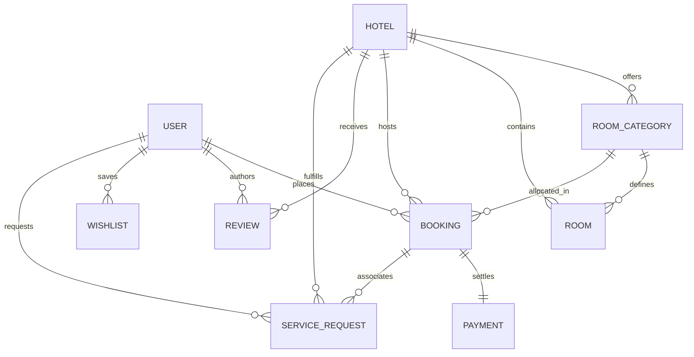
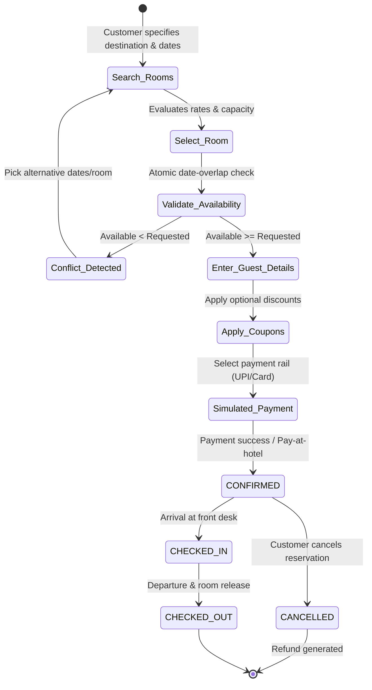

# StayEase – Software Design & Architecture Document

> **Domain:** Tourism and Hospitality Management System  
> **Course:** Software Design & Engineering Mini-Project  
> **System Name:** StayEase Smart Hotel Room Reservation System  

---

## 1. System Overview & Scope

StayEase is an enterprise-grade, full-stack hotel reservation platform designed to handle hotel discovery, multi-criteria room filtering, concurrency-safe reservations, simulated financial settlements, and in-room concierge workflows.

### Core Objectives
1. **Zero Double-Booking Guarantee**: Concurrency control via atomic date-overlap queries.
2. **Role-Based Access Control (RBAC)**: Clear delineation between Customer and Administrator domains.
3. **Responsive Luxury UX**: High-performance client with sub-second page transitions, animated feedback, and intuitive booking steps.
4. **Relational Data Integrity**: SQLite backed by Prisma ORM with strict foreign key constraints and cascade rules.

---

## 2. Software Architecture

StayEase adopts a modular **N-Tier Layered Architecture**:

```
+-----------------------------------------------------------+
|                      Presentation Tier                    |
|       React 18 + TypeScript + Vite + Tailwind CSS         |
|  (State Management via Context API, Animated Transitions) |
+-----------------------------+-----------------------------+
                              | HTTPS / JSON (REST API)
+-----------------------------v-----------------------------+
|                      Application Tier                     |
|                 Node.js + Express.js Engine               |
|  Controllers -> Services -> Middleware (JWT/Bcrypt/Error) |
+-----------------------------+-----------------------------+
                              | Prisma ORM (Type-Safe SQL)
+-----------------------------v-----------------------------+
|                        Data Tier                          |
|               SQLite Relational Database                  |
+-----------------------------------------------------------+
```

---

## 3. Entity-Relationship (ER) Diagram



---

## 4. Reservation State Transition Machine



---

## 5. Software Design Patterns Implemented

| Pattern | Component | Purpose & Implementation |
| :--- | :--- | :--- |
| **Singleton Pattern** | `server/src/utils/prisma.ts` | Prevents exhausting SQLite file handles by maintaining a single global Prisma Client instance. |
| **Model-View-Controller (MVC)** | `server/src/controllers/` | Isolates business logic from routing, HTTP status handling, and schema definitions. |
| **Strategy Pattern** | `server/src/controllers/couponController.ts` | Computes dynamic price discounts either through `PERCENTAGE` with caps or `FIXED` reductions. |
| **Atomic Transaction Pattern** | `server/src/controllers/bookingController.ts` | Uses `prisma.$transaction()` to ensure booking creation and payment issuance happen atomically or fail entirely. |
| **Observer / Interceptor Pattern**| `client/src/api/client.ts` | Axios request interceptors automatically attach JWT bearer credentials and handle 401 unauth session invalidations. |

---

## 6. Concurrency & Double-Booking Prevention

### The Overlap Condition
A room category cannot be booked for a requested interval $[T_{in}, T_{out}]$ if active bookings violate:
$$\text{Overlap} \iff (\text{ExistingCheckIn} < T_{out}) \land (\text{ExistingCheckOut} > T_{in}) \land (\text{Status} \in \{\text{'CONFIRMED'}, \text{'CHECKED\_IN'}\})$$

### Execution Logic
1. Count total rooms in category: $N_{total}$.
2. Query the sum of rooms allocated in overlapping intervals: $N_{booked}$.
3. Calculate real-time available rooms: $N_{avail} = N_{total} - N_{booked}$.
4. If $N_{avail} < N_{requested}$, return HTTP `409 Conflict` with clear user advice.
5. If $N_{avail} \ge N_{requested}$, assign specific available physical room numbers (`DEL-101`, `EXE-102`) and commit transaction.

---

## 7. REST API Endpoints Specification

### Authentication
- `POST /api/auth/register`: Register new customer account
- `POST /api/auth/login`: Authenticate customer/admin and issue JWT
- `GET /api/auth/me`: Fetch authenticated user profile
- `PUT /api/auth/profile`: Update name, phone, or password

### Hotels & Room Categories
- `GET /api/hotels`: List hotels with query filters (`city`, `minPrice`, `maxPrice`, `starRating`, `amenities`, `sortBy`)
- `GET /api/hotels/:id`: Detailed hotel profile with room categories and customer reviews
- `GET /api/hotels/destinations`: Aggregated destination statistics across major Indian cities

### Bookings & Concurrency
- `POST /api/bookings/calculate`: Server-side nightly rate, GST tax, and coupon discount calculation
- `POST /api/bookings`: Commit atomic reservation and create simulated payment record
- `GET /api/bookings/my`: List customer's own active, previous, and cancelled bookings
- `GET /api/bookings/:id`: Retrieve single booking pass and itemized invoice
- `PATCH /api/bookings/:id/cancel`: Cancel reservation and mark payment as `REFUNDED`

### Concierge Services
- `POST /api/services`: Dispatch in-room service request (cleaning, dining, laundry, maintenance, pickup)
- `GET /api/services/my`: Fetch service requests created by authenticated guest
- `PATCH /api/services/:id/status`: Update service request workflow state

### Admin Management (`/api/admin/*`)
- `GET /api/admin/stats`: KPI metrics and monthly chart aggregation
- `POST /api/admin/hotels`, `PUT /api/admin/hotels/:id`, `DELETE /api/admin/hotels/:id`
- `POST /api/admin/room-categories`, `PUT /api/admin/room-categories/:id`, `DELETE /api/admin/room-categories/:id`
- `GET /api/admin/bookings`, `PATCH /api/admin/bookings/:id/status`
- `GET /api/admin/services`
- `GET /api/admin/customers`
- `GET /api/admin/payments`
- `GET /api/admin/coupons`, `POST /api/admin/coupons`, `DELETE /api/admin/coupons/:id`, `PATCH /api/admin/coupons/:id/toggle`
- `GET /api/admin/reviews`, `DELETE /api/admin/reviews/:id`
